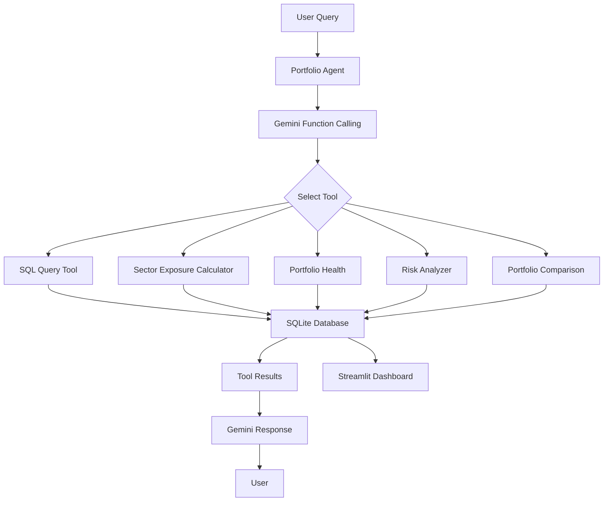

# PL Capital – AI Portfolio Analytics Agent

An AI-powered portfolio analytics system that translates natural-language questions into database queries, calculates sector exposures, and provides portfolio health and risk insights through an interactive dashboard.

## 1. Project Overview

The **PL Capital AI Portfolio Analytics Agent** is designed to make portfolio data easier to query and understand.

Users can ask questions in natural language, allowing the AI agent to select and execute the appropriate analytical tool. The system combines Gemini function calling, SQLite database operations and Python-based financial analytics.

In addition to the required SQL and sector exposure tools, the project includes portfolio health analysis, risk analysis, portfolio comparison and a Streamlit dashboard.

## 2. Key Features

### AI-Powered Querying
- Converts natural-language questions into SQL queries.
- Uses Gemini function calling to select the appropriate tool.
- Executes database queries and returns understandable responses.
- Maintains tool execution details for inspection.

### Sector Exposure Calculator
- Calculates sector-wise portfolio exposure.
- Combines holding weights with security-sector mappings.
- Excludes bond holdings and considers equities only.
- Reports sector exposure percentages.

### Portfolio Health Analysis
- Analyzes portfolio allocation and sector concentration.
- Evaluates available performance and risk metrics.
- Identifies potential portfolio health alerts.
- Handles missing analytical data.

### Risk Intelligence
- Analyzes available portfolio risk metrics.
- Identifies risk levels and potential concentration concerns.
- Provides risk-related alerts.

### Portfolio Comparison
- Compares two portfolios across available performance and risk metrics.
- Compares asset allocation and sector exposure.
- Highlights differences in concentration and data availability.

### Interactive Dashboard
The Streamlit dashboard provides five pages:

1. **Overview:** Portfolio-level analytics and key indicators.
2. **Portfolio Explorer:** Portfolio holdings, allocation and sector exposure.
3. **Risk Intelligence:** Risk metrics and portfolio risk insights.
4. **Portfolio Comparison:** Side-by-side portfolio analysis.
5. **AI Analyst:** Natural-language interaction with the portfolio agent.

## 3. System Architecture

The application follows a modular architecture that separates AI orchestration, database operations, financial calculations and presentation.



### Agent Tools

The agent registers five tools:

| Tool | Responsibility |
|---|---|
| `run_sql_query` | Executes validated, read-only SQL queries |
| `calculate_sector_exposure` | Calculates equity sector exposures |
| `analyze_portfolio_health` | Evaluates portfolio health |
| `analyze_portfolio_risk` | Analyzes portfolio risk |
| `compare_portfolios` | Compares two portfolios |

Gemini determines which tool is appropriate for a user query and invokes the registered function.

## 4. Technology Stack

| Technology | Purpose |
|---|---|
| Python | Application development |
| Google Gemini API | AI reasoning and function calling |
| Google GenAI SDK | Gemini API integration |
| SQLite | Portfolio database |
| Pandas | Data processing and analysis |
| Plotly | Interactive visualizations |
| Streamlit | Dashboard development |
| Pytest | Automated testing |

## 5. Project Structure

```text
PL-Capital-Portfolio-Analytics-Agent/
│
├── dashboard/
│   ├── app.py
│   └── pages/
│       ├── 1_Portfolio_Explorer.py
│       ├── 2_Risk_Intelligence.py
│       ├── 3_Portfolio_Comparison.py
│       └── 4_AI_Analyst.py
│
├── data/
│   ├── benchmarks.csv
│   ├── historical_prices.csv
│   ├── holdings.csv
│   ├── portfolio_performance.csv
│   ├── portfolios.csv
│   ├── risk_metrics.csv
│   ├── sectors.csv
│   ├── securities.csv
│   └── transactions.csv
│
├── src/
│   ├── agent.py
│   ├── database.py
│   ├── evaluator.py
│   ├── exposure_calculator.py
│   ├── main.py
│   ├── portfolio_comparison.py
│   ├── portfolio_health.py
│   ├── risk_analyzer.py
│   ├── run_evaluation.py
│   └── sql_tool.py
│
├── tests/
│   └── test_backend.py
│
├── portfolio_database.db
├── database_schema.sql
├── ground_truth_dataset.json
├── requirements.txt
├── README.md
└── .gitignore
```

## 6. Database and Data Handling

The project uses SQLite as its relational database.

The repository includes a prebuilt `portfolio_database.db`, so database initialization from the CSV files is not required for normal execution.

The database contains nine tables:

- Portfolios
- Sectors
- Securities
- Holdings
- Transactions
- Benchmarks
- Historical Prices
- Portfolio Performance
- Risk Metrics

The SQL execution layer uses read-only database access and validates queries before execution.

## 7. Installation and Configuration

### Prerequisites

- Python 3.10 or later
- Git
- Google AI Studio API key

### Step 1: Clone the repository

```bash
git clone https://github.com/prataprishi0707/PL-Capital-Portfolio-Analytics-Agent.git

cd PL-Capital-Portfolio-Analytics-Agent
```

### Step 2: Install dependencies

```bash
pip install -r requirements.txt
```

### Step 3: Configure the Gemini API key

Obtain an API key from [Google AI Studio](https://aistudio.google.com/).

Set the environment variable `GOOGLE_API_KEY`.

**Windows PowerShell:**

```powershell
$env:GOOGLE_API_KEY="YOUR_API_KEY"
```

**Linux / macOS:**

```bash
export GOOGLE_API_KEY="YOUR_API_KEY"
```

Do not commit API keys or other credentials to GitHub.

### Step 4: Verify the database

Ensure that `portfolio_database.db` exists in the project root.

The application uses this existing database directly.

## 8. Running the Application

### Run the command-line AI agent

```bash
python src/main.py
```

Ask a specific question:

```bash
python src/main.py --question "How many portfolios are stored in the database?"
```

Example verified interaction:

**User Query:**

How many portfolios are stored in the database?

**Selected Tool:**

`run_sql_query`

**Generated SQL:**

```sql
SELECT COUNT(*) AS total_portfolios
FROM portfolios;
```

**Database Result:**

13 portfolios.

This example represents one successfully verified end-to-end Gemini function-calling interaction.

### Run the Streamlit dashboard

```bash
streamlit run dashboard/app.py
```

The dashboard will be accessible at the local URL provided by Streamlit, usually:

```text
http://localhost:8501
```

## 9. Agent Evaluation

The project includes a ground-truth dataset and an automated evaluation framework.

The evaluator checks:
- Whether the agent selects the expected tool.
- Whether SQL query results match the expected database results.
- Whether calculated sector exposures match independently calculated reference values.

### Run the complete evaluation

```bash
python src/run_evaluation.py
```

### Evaluate a limited number of questions

```bash
python src/run_evaluation.py --limit 3
```

Evaluation results are saved to `evaluation_results.json`.

The evaluation framework distinguishes functional failures from API availability errors.

## 10. Testing and Verification

The project includes automated backend regression tests and additional validation checks.

### Run backend tests

```bash
python -m pytest tests/ -v
```

### Verified Development Results

| Test / Verification | Result |
|---|---|
| SQL Query Tool smoke test | Passed |
| Exposure Calculator smoke test | Passed |
| Portfolio Health smoke test | Passed |
| Portfolio Comparison smoke test | Passed |
| Risk Analyzer smoke test | Passed |
| Backend regression tests | 18/18 passed |
| Result comparison unit tests | 5/5 passed |
| Exposure ground-truth tests | 2/2 passed |
| Offline tool-selection logic tests | 5/5 passed |
| API-error classification tests | 6/6 passed |
| SQL write-operation rejection | Passed |
| Multiple-statement rejection | Passed |
| Database integrity verification | Passed |
| Agent tool registration | 5 tools registered |
| Dashboard Python syntax | 5/5 files passed |
| Streamlit health endpoint | HTTP 200 |
| Dashboard browser review | All five pages checked |

### SQL Safety Verification

The SQL execution layer was tested against:

- INSERT, UPDATE and DELETE operations.
- DROP TABLE, ALTER TABLE and CREATE TABLE operations.
- Write-style PRAGMA operations.
- Multiple SQL statements in one request.
- Invalid table references.

All tested write attempts and multiple-statement requests were rejected.

Database integrity verification confirmed that:
- All 13 portfolio records remained present.
- All nine original database tables remained present.
- PRAGMA user_version remained unchanged at 0.

## 11. Evaluation Status and Limitations

The following development checks have been completed:

- 18/18 automated backend tests passed.
- 5/5 result comparison unit tests passed.
- Both exposure ground-truth tests passed.
- Offline tool-selection logic tests passed.
- API-error classification tests passed.
- One successful end-to-end Gemini SQL function-calling interaction returned the correct result.

**Live AI evaluation limitation:**

The complete 10-question ground-truth evaluation has not yet been verified. Subsequent Gemini API requests encountered HTTP 503 service-unavailability errors before tool selection.

Therefore:
- No overall live agent accuracy percentage is claimed.
- Live exposure-tool selection remains unverified.
- Offline backend and evaluator tests are reported separately from live AI evaluation.

**Data limitations:**

- Portfolio performance and risk records are historical sample data, not live market data.
- Risk thresholds and alerts are illustrative and should not be interpreted as official investment or risk-management limits.
- The project is an analytics demonstration, not an investment recommendation system.

## 12. Future Improvements

Potential future enhancements include:

- More comprehensive live agent evaluation.
- Hybrid questions requiring multiple tools.
- Improved SQL query performance evaluation.
- Caching for repeated analytical queries.
- Expanded logging and monitoring.
- REST API integration.
- Multi-user support.
- Additional portfolio analytics and visualization capabilities.**
